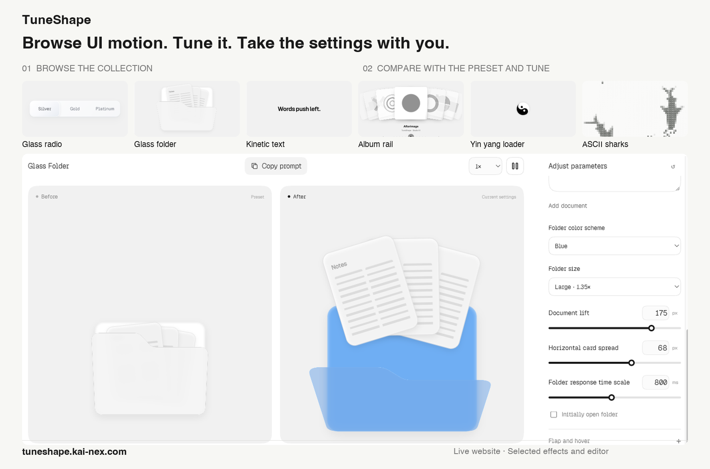

# TuneShape · 随形

**English** · [简体中文](README.zh-CN.md)

**Explore UI motion, adjust it live, and take the settings into your project.**

TuneShape is a browser tool for designers and developers to try UI effects and adjust how they look and behave. Browse the catalog, compare your changes with the preset, then export the configuration or copy an implementation prompt. The interface is available in English and Chinese.

### [Open TuneShape in your browser →](https://tuneshape.kai-nex.com/)

**Live demo · Browse → Tune → Export**

[](https://tuneshape.kai-nex.com/)

*About 15 seconds, recorded from the live website. The example adjusts Glass Folder's color, size, and card spread, then exports its current configuration.*

## Try an effect in three steps

1. **Browse** — Choose an effect by category or search for its Chinese or English name. Try the interaction in its catalog card.
2. **Tune** — Open the effect, change its parameters, and compare the current settings with the preset.
3. **Reuse** — Export the JSON configuration or copy the implementation prompt to continue in your own project.

## Explore the collection

[](https://tuneshape.kai-nex.com/)

*The overview shows the online editor. The local examples included in this repository are described below.*

## What you can do on the website

| Task | Available tools |
| --- | --- |
| Find an effect | Categories for controls, navigation, containers, text, images, indicators, and backgrounds; Chinese and English search |
| Adjust the result | Effect-specific controls for content, appearance, timing, easing, and motion |
| Compare behavior | Preset and current-setting previews, playback controls, and observation speed |
| Bring it into a project | JSON import/export, motion specifications, implementation prompts, offline HTML, and standalone reproduction projects |

The editor supports pointer, keyboard, and touch interactions, with reduced-motion behavior. Available controls and interactions vary by effect.

Export JSON before refreshing or leaving the page: effect parameters are kept for the current page session. Playback progress and observation speed are tool state rather than saved effect settings.

**[Try your own settings on TuneShape →](https://tuneshape.kai-nex.com/)**

## About this repository

**Rendering source for all 42 effects in the visible catalog is public.** Each includes a default configuration, runnable page, and English/Chinese documentation. [Run the examples](effects/README.md) · [Machine-readable catalog](effects/catalog.json) · [Effect guides](https://tuneshape.kai-nex.com/en/effects/)

```sh
git clone https://github.com/orocoa/TuneShape.git
cd TuneShape/effects
pnpm install --frozen-lockfile
pnpm dev
```

| Effect ID | English | 中文 |
| --- | --- | --- |
| basic-button | [Button Press Feedback](effects/examples/basic-button/README.md) | [按钮按压反馈](effects/examples/basic-button/README.zh-CN.md) |
| hover-invert | [Hover Color Transition](effects/examples/hover-invert/README.md) | [悬停配色过渡](effects/examples/hover-invert/README.zh-CN.md) |
| duration-picker | [Duration Picker](effects/examples/duration-picker/README.md) | [时长选择器](effects/examples/duration-picker/README.zh-CN.md) |
| glass-radio | [Glass Segmented Radio Control](effects/examples/glass-radio/README.md) | [玻璃分段单选](effects/examples/glass-radio/README.zh-CN.md) |
| dropdown | [Dropdown Menu](effects/examples/dropdown/README.md) | [下拉菜单](effects/examples/dropdown/README.zh-CN.md) |
| folder | [Folder](effects/examples/folder/README.md) | [文件夹](effects/examples/folder/README.zh-CN.md) |
| glass-folder | [Glass Folder](effects/examples/glass-folder/README.md) | [磨砂文件夹](effects/examples/glass-folder/README.zh-CN.md) |
| scroll-progress | [Scroll Progress](effects/examples/scroll-progress/README.md) | [阅读进度胶囊](effects/examples/scroll-progress/README.zh-CN.md) |
| hook-sidebar | [Hook Sidebar](effects/examples/hook-sidebar/README.md) | [钩线侧栏](effects/examples/hook-sidebar/README.zh-CN.md) |
| rail-toc | [Rail TOC](effects/examples/rail-toc/README.md) | [纸飞机目录](effects/examples/rail-toc/README.zh-CN.md) |
| card-morph | [Card Expansion](effects/examples/card-morph/README.md) | [卡片展开](effects/examples/card-morph/README.zh-CN.md) |
| typewriter-text | [Typewriter Text](effects/examples/typewriter-text/README.md) | [逐字打出](effects/examples/typewriter-text/README.zh-CN.md) |
| soft-blur-in | [Soft Blur In](effects/examples/soft-blur-in/README.md) | [柔焦入场](effects/examples/soft-blur-in/README.zh-CN.md) |
| short-slide-down | [Short Slide Down](effects/examples/short-slide-down/README.md) | [落词堆叠](effects/examples/short-slide-down/README.zh-CN.md) |
| kinetic-center-build | [Kinetic Center Build](effects/examples/kinetic-center-build/README.md) | [居中推词](effects/examples/kinetic-center-build/README.zh-CN.md) |
| period-drop | [Period Drop](effects/examples/period-drop/README.md) | [句点弹落](effects/examples/period-drop/README.zh-CN.md) |
| outline-trace | [Outline Trace](effects/examples/outline-trace/README.md) | [字形描边](effects/examples/outline-trace/README.zh-CN.md) |
| glyph-anatomy | [Glyph Anatomy](effects/examples/glyph-anatomy/README.md) | [字形构建](effects/examples/glyph-anatomy/README.zh-CN.md) |
| encrypted-text | [Encrypted Text](effects/examples/encrypted-text/README.md) | [逐字解码](effects/examples/encrypted-text/README.zh-CN.md) |
| gooey-input | [Gooey Input](effects/examples/gooey-input/README.md) | [黏性搜索输入](effects/examples/gooey-input/README.zh-CN.md) |
| flip-words | [Flip Words](effects/examples/flip-words/README.md) | [词语翻替](effects/examples/flip-words/README.zh-CN.md) |
| coffee-selector | [Selector](effects/examples/coffee-selector/README.md) | [选择器](effects/examples/coffee-selector/README.zh-CN.md) |
| rounded-checks | [Rounded Checkboxes](effects/examples/rounded-checks/README.md) | [圆角复选框](effects/examples/rounded-checks/README.zh-CN.md) |
| mini-sidebar | [Page Navigation](effects/examples/mini-sidebar/README.md) | [页面导航](effects/examples/mini-sidebar/README.zh-CN.md) |
| text-rise | [Staggered Character Reveal](effects/examples/text-rise/README.md) | [文字逐字上移揭示](effects/examples/text-rise/README.zh-CN.md) |
| text-scramble | [Local Text Scramble and Recovery](effects/examples/text-scramble/README.md) | [局部字符扰动与恢复](effects/examples/text-scramble/README.zh-CN.md) |
| glyph-wall | [Glyph Decode Wall](effects/examples/glyph-wall/README.md) | [文字解码墙](effects/examples/glyph-wall/README.zh-CN.md) |
| hover-preview | [Hover Preview](effects/examples/hover-preview/README.md) | [文字悬停图片](effects/examples/hover-preview/README.zh-CN.md) |
| album-rail | [Album Rail](effects/examples/album-rail/README.md) | [唱片轨道](effects/examples/album-rail/README.zh-CN.md) |
| orbit-reel | [Orbit Reel](effects/examples/orbit-reel/README.md) | [卡片转轮](effects/examples/orbit-reel/README.zh-CN.md) |
| elastic-reel | [Elastic Reel](effects/examples/elastic-reel/README.md) | [弹性相片卷](effects/examples/elastic-reel/README.zh-CN.md) |
| dots | [Staggered Loading Dots](effects/examples/dots/README.md) | [三点交错跳动](effects/examples/dots/README.zh-CN.md) |
| finger-tap | [Finger Tapping](effects/examples/finger-tap/README.md) | [手指敲击](effects/examples/finger-tap/README.zh-CN.md) |
| typewriter | [Typewriter](effects/examples/typewriter/README.md) | [打字机](effects/examples/typewriter/README.zh-CN.md) |
| yin-yang | [Yin Yang Loader](effects/examples/yin-yang/README.md) | [太极加载](effects/examples/yin-yang/README.zh-CN.md) |
| pulse | [Pulse Scale and Ripple](effects/examples/pulse/README.md) | [脉冲缩放与扩散](effects/examples/pulse/README.zh-CN.md) |
| watercolor | [Watercolor Blend](effects/examples/watercolor/README.md) | [水彩融合](effects/examples/watercolor/README.zh-CN.md) |
| watercolor-original | [Watercolor Original](effects/examples/watercolor-original/README.md) | [水彩模糊](effects/examples/watercolor-original/README.zh-CN.md) |
| watercolor-flow | [Watercolor Flow](effects/examples/watercolor-flow/README.md) | [细度水彩融合](effects/examples/watercolor-flow/README.zh-CN.md) |
| ascii-sharks | [ASCII Sharks](effects/examples/ascii-sharks/README.md) | [ASCII 鲨鱼群](effects/examples/ascii-sharks/README.zh-CN.md) |
| particle-tide | [Particle Tide](effects/examples/particle-tide/README.md) | [粒子海浪](effects/examples/particle-tide/README.zh-CN.md) |
| ascii-wave | [ASCII Wave Animation](effects/examples/ascii-wave/README.md) | [ASCII 波形动画](effects/examples/ascii-wave/README.zh-CN.md) |

The effect package uses the same rendering components as the website. The full website editor, deployment configuration, and work records are outside this package. The original three React basic examples and standalone ASCII Shoal module remain available; their setup is preserved below.

<details>
<summary>Local setup, example configuration, and source guide</summary>

### Examples

| Example | Interaction | Configuration | Prompt |
| --- | --- | --- | --- |
| Button press feedback | Press and release with a pointer, Space, or Enter | [button.json](configs/button.json) | [button.md](prompts/button.md) |
| Tab transitions | Switch panels with a pointer or arrow keys; Home and End are supported | [tabs.json](configs/tabs.json) | [tabs.md](prompts/tabs.md) |
| In-page dialog | Open, close, or dismiss with Escape; focus returns to the trigger | [modal.json](configs/modal.json) | [modal.md](prompts/modal.md) |

The dialog demonstrates an entrance and exit inside the preview area. It uses `aria-modal="false"` and does not trap focus across the application.

### ASCII Shoal background

[`examples/ascii-shoal/`](examples/ascii-shoal/) is a standalone JavaScript Canvas background with swimming silhouettes, small fish, configurable ASCII sampling density, glyph size, palette, and playback. It has no runtime dependencies and does not require the React examples to be installed.

The implementation uses newly authored shapes and motion paths, applying the grid-and-character approach used by TuneShape's ASCII wave effect. Its source and implementation notes are included in the example. See the [example README](examples/ascii-shoal/README.md) for local preview, embedding, configuration, and lifecycle controls.

```sh
cd examples/ascii-shoal
npm run dev
# Stop the preview server before running the following commands.
node --test test/*.test.mjs
npm run build
```

The build writes the standalone demo to `examples/ascii-shoal/dist/`. The root commands below continue to operate on the three React examples.

### Quick start

#### Requirements

- Node.js **22.12 or later**. CI runs on Node.js 24.
- pnpm **11.x**. Use the exact version declared in [`package.json`](package.json) under `packageManager`.

#### Install and run

```sh
git clone https://github.com/orocoa/TuneShape.git
cd TuneShape
pnpm install --frozen-lockfile
pnpm dev
```

Open the local URL printed by Vite. If you downloaded a release ZIP, extract it and run the last two commands from the directory containing `package.json`.

Package installation requires access to the package registry. Once dependencies are installed, the examples run locally without an account, API key, database, or connection to the TuneShape website.

### Commands

| Command | Purpose |
| --- | --- |
| `pnpm dev` | Start the local development server |
| `pnpm test` | Run configuration, validation, and interaction-contract tests |
| `pnpm build` | Run TypeScript checks and create the static production build in `dist/` |
| `pnpm preview` | Preview an existing production build locally |

Build before running `pnpm preview`. Deploy the contents of `dist/` to a static web host.

### Configure an example

Select `button`, `tabs`, or `modal` in the demo to load its defaults. To apply an exact configuration:

1. Open **Edit the exact configuration**.
2. Paste a complete configuration from `configs/` or a schema version 1 export from the online editor.
3. Select **Apply configuration**.

The configuration includes the component type, so applying it selects the corresponding example. You can also edit [`config.json`](config.json) before starting or building to set the initial example. Selecting another example in the navigation loads that example's defaults.

Supported settings include tween and spring transitions, delay, easing, transform values, and physical spring parameters. Invalid or incompatible configurations are rejected with a validation message. The playback control supports pause and resume; the examples respond to live `prefers-reduced-motion` changes.

### Reproduce an example with its Prompt

Each file in [`prompts/`](prompts/) contains the interaction rules, exact JSON configuration, and Motion state and transition contract for the corresponding example in [`configs/`](configs/).

1. Choose the matching configuration and Prompt from the table above.
2. Use the Prompt together with this repository's implementation and supporting modules.
3. Apply the Prompt's **Exact configuration** to the demo or save it as `config.json`.
4. Run `pnpm test` and `pnpm build`.
5. Check pointer and keyboard input, repeated input, animation interruption, pause/resume, and reduced motion in the browser.

The included source and validated configuration define the reference behavior. AI-generated implementations should be checked against that contract; natural-language input alone does not guarantee identical generated code. The examples reproduce the basic interaction and parameters using the simplified styling in this package.

### Source guide

| Path | Responsibility |
| --- | --- |
| [`src/main.tsx`](src/main.tsx) | Demo navigation, JSON editor, and playback controls |
| [`src/Preview.tsx`](src/Preview.tsx) | Button, tabs, and dialog rendering and interaction |
| [`src/model.ts`](src/model.ts) | Configuration validation, state mapping, and Motion specifications |
| [`src/easing.ts`](src/easing.ts) | Easing validation and evaluation |
| [`src/useDetailPlayback.ts`](src/useDetailPlayback.ts) | Playback state and animation-clock control |
| [`src/usePrefersReducedMotion.ts`](src/usePrefersReducedMotion.ts) | Live system motion-preference handling |
| [`src/model.test.ts`](src/model.test.ts) | Configuration round trips, boundaries, and interaction contracts |
| [`src/style.css`](src/style.css) | System-font demo styling and responsive layout |
| `configs/` / `prompts/` | Matching configuration snapshots and implementation Prompts |

### Release integrity

GitHub release archives include `SOURCE_MANIFEST.json`, which records the exported files, byte lengths, and SHA-256 hashes. Its own hash is excluded to avoid a circular digest. Each release also provides `SHA256SUMS.txt` for its ZIP archive.

Download the ZIP and checksum file into the same directory, then verify the archive:

```sh
# macOS
shasum -a 256 -c SHA256SUMS.txt
```

```sh
# Linux
sha256sum -c SHA256SUMS.txt
```

The manifest describes the published snapshot. Local edits to a listed file will change its hash.

</details>

## Feedback and contributing

For a bug or an effect request, [open an issue](https://github.com/orocoa/TuneShape/issues). Include the effect name, browser or device, steps to reproduce, and the result you expected. Issues and pull requests may be written in English or Chinese.

For changes to the included source, see [CONTRIBUTING.md](CONTRIBUTING.md). Published versions are listed under [Releases](https://github.com/orocoa/TuneShape/releases). Maintained by [orocoa](https://github.com/orocoa).

## License

The source code and documentation published in this repository are available under the [MIT License](LICENSE). Third-party dependencies and materials shown in website previews retain their respective licenses; the website preview does not grant rights to third-party assets.
