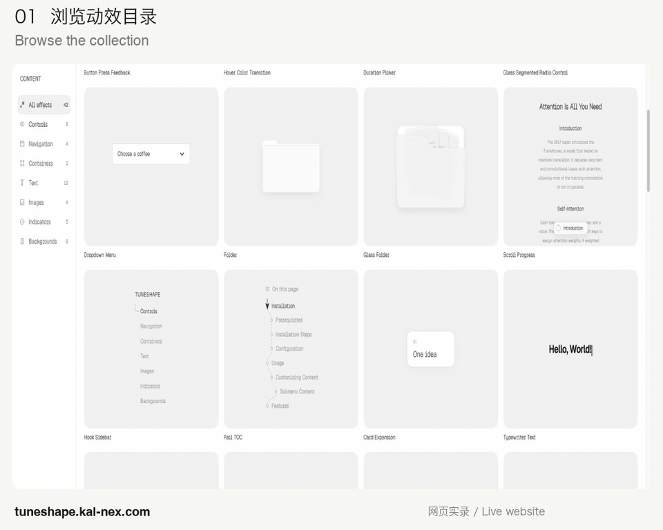
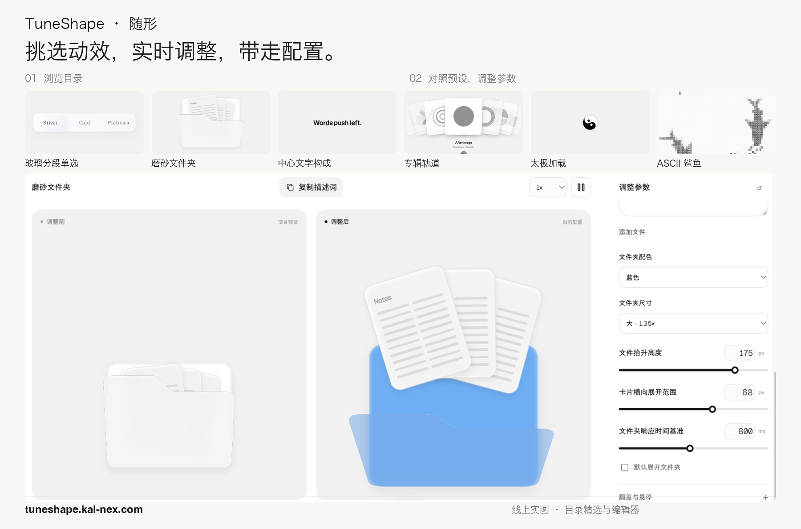

# TuneShape · 随形

[English](README.md) · **简体中文**

**挑选 UI 动效，实时调整，把配置带回你的项目。**

TuneShape，中文名「随形」，是面向设计师与开发者的 UI 动效网页工具。浏览目录，调整效果的外观与交互，对照预设查看变化，再导出配置，或复制实现 Prompt。界面支持中文和英文。

### [打开 TuneShape 网页，直接体验 →](https://tuneshape.kai-nex.com/)

**操作动图 · 浏览 → 调整 → 导出**

[](https://tuneshape.kai-nex.com/)

*约 15 秒，录自真实网页。以磨砂文件夹演示配色、尺寸和卡片展开范围的调整，以及当前配置的导出。*

## 三步试用一个动效

1. **浏览** — 按分类选择效果，或搜索中英文名称，在目录卡片中直接试用交互。
2. **调整** — 打开详情，修改参数，对照预设查看当前配置的变化。
3. **复用** — 导出 JSON 配置，或复制实现 Prompt，带回自己的项目继续使用。

## 动效与调参总览

[](https://tuneshape.kai-nex.com/)

*总览图展示在线编辑器。本仓库包含的本地示例见下方说明。*

## 网页提供什么

| 你想做的事 | 可以使用的工具 |
| --- | --- |
| 找到合适效果 | 控件、导航、容器、文字、图片、状态指示和背景分类，以及中英文搜索 |
| 调整效果 | 各动效对应的内容、外观、时长、缓动与运动参数 |
| 比较交互表现 | 预设与当前配置的并排预览、播放控制与观察倍速 |
| 带回项目复用 | JSON 导入导出、动效规格、实现 Prompt、离线 HTML 与独立复刻工程 |

编辑器支持指针、键盘和触屏交互，并提供减少动态效果的处理。具体控件和交互方式随动效而异。

刷新或离开页面前，请导出 JSON：动效参数仅保留在当前页面会话中。播放进度与观察倍速属于工具状态，不会写入动效配置。

**[到 TuneShape，试试自己的参数 →](https://tuneshape.kai-nex.com/)**

## 关于本仓库

上方截图和动图展示完整在线编辑器。本仓库包含三个可运行的 React、TypeScript 与 Motion 示例：按钮按压反馈、Tab 切换和页内对话框，以及一个独立的 Canvas ASCII 鱼群背景。完整网站、目录、编辑器面板和其他动效实现由独立工程维护。

<details>
<summary>本地运行、示例配置与源码说明</summary>

### 基础示例

| 示例 | 交互方式 | 配置 | Prompt |
| --- | --- | --- | --- |
| 按钮按压反馈 | 指针、空格键或 Enter 键按下与释放 | [button.json](configs/button.json) | [button.md](prompts/button.md) |
| Tab 切换过渡 | 指针或方向键切换内容，支持 Home 和 End 键 | [tabs.json](configs/tabs.json) | [tabs.md](prompts/tabs.md) |
| 页内对话框 | 打开、关闭或按 Escape 退出，关闭后焦点返回触发按钮 | [modal.json](configs/modal.json) | [modal.md](prompts/modal.md) |

对话框用于演示预览区域内的进入与退出，使用 `aria-modal="false"`，不限制整个应用的键盘焦点。

### ASCII 鱼群背景

[`examples/ascii-shoal/`](examples/ascii-shoal/) 是独立的 JavaScript Canvas 背景模块，提供游动轮廓、小鱼、可调整的 ASCII 采样密度、字符大小、配色和播放控制。无需运行时依赖，也无需先安装 React 基础示例。

这份实现使用新编写的形状和运动路径，沿用 TuneShape ASCII 波形效果的网格采样与字符映射思路。示例目录包含源码和实现说明；本地预览、嵌入、参数和生命周期控制见[示例 README](examples/ascii-shoal/README.zh-CN.md)。

```sh
cd examples/ascii-shoal
npm run dev
# 停止预览服务后，再运行以下命令。
node --test test/*.test.mjs
npm run build
```

构建会将独立演示输出到 `examples/ascii-shoal/dist/`。以下仓库根目录命令仍用于三个 React 基础示例。

### 快速开始

#### 环境要求

- Node.js **22.12 或更高版本**。CI 使用 Node.js 24。
- pnpm **11.x**。请使用 [`package.json`](package.json) 的 `packageManager` 字段声明的具体版本。

#### 安装与运行

```sh
git clone https://github.com/orocoa/TuneShape.git
cd TuneShape
pnpm install --frozen-lockfile
pnpm dev
```

在浏览器中打开 Vite 输出的本地地址。如果下载的是 Release ZIP，请先解压，再进入包含 `package.json` 的目录，执行最后两条命令。

安装依赖时需要访问软件包仓库。依赖安装完成后，示例可以在本地运行，无需账号、API Key、数据库或连接 TuneShape 网站。

### 常用命令

| 命令 | 用途 |
| --- | --- |
| `pnpm dev` | 启动本地开发服务器 |
| `pnpm test` | 执行配置、校验和交互契约测试 |
| `pnpm build` | 执行 TypeScript 检查，将静态生产文件输出到 `dist/` |
| `pnpm preview` | 在本地预览已生成的生产构建 |

使用 `pnpm preview` 前，请先执行构建。部署时，将 `dist/` 中的内容发布到静态网站托管服务即可。

### 配置示例

在演示页面选择 `button`、`tabs` 或 `modal`，可以加载对应示例的默认参数。应用精确配置的方法如下：

1. 展开 **Edit the exact configuration**。
2. 粘贴 `configs/` 中的完整配置，或在线编辑器导出的 schema version 1 配置。
3. 点击 **Apply configuration**。

配置包含组件类型，应用后会切换到对应示例。也可以在启动或构建前修改 [`config.json`](config.json)，设置初始示例。通过导航切换示例时，会加载新示例的默认配置。

支持补间与弹簧过渡、延迟、缓动、变换值，以及物理型弹簧参数。非法或不兼容的配置会被拒绝，并显示校验提示。播放控件支持暂停与继续；示例会实时响应系统 `prefers-reduced-motion` 设置。

### 使用对应 Prompt 复刻

[`prompts/`](prompts/) 中的每份文件都包含对应示例的交互规则、精确 JSON 配置，以及 Motion 状态和过渡契约，与 [`configs/`](configs/) 中的配置一一对应。

1. 从上表选择配套的配置和 Prompt。
2. 将 Prompt 与本仓库的实现及依赖模块一起使用。
3. 将 Prompt 中的 **Exact configuration** 应用到演示页面，或保存为 `config.json`。
4. 执行 `pnpm test` 和 `pnpm build`。
5. 在浏览器中检查指针与键盘输入、重复操作、动画打断、暂停继续和减少动态效果。

仓库中的源码与经过校验的配置共同定义参考行为。使用 AI 生成其他实现后，应按照该契约验收；仅凭自然语言输入无法保证生成逐字节相同的代码。基础示例使用本包的简化样式复现对应交互和参数。

### 源码导航

| 路径 | 职责 |
| --- | --- |
| [`src/main.tsx`](src/main.tsx) | 示例导航、JSON 编辑器和播放控件 |
| [`src/Preview.tsx`](src/Preview.tsx) | 按钮、Tab 和对话框的渲染与交互 |
| [`src/model.ts`](src/model.ts) | 配置校验、状态映射和 Motion 规格 |
| [`src/easing.ts`](src/easing.ts) | 缓动配置的校验与计算 |
| [`src/useDetailPlayback.ts`](src/useDetailPlayback.ts) | 播放状态和动画时钟控制 |
| [`src/usePrefersReducedMotion.ts`](src/usePrefersReducedMotion.ts) | 实时响应系统动态效果偏好 |
| [`src/model.test.ts`](src/model.test.ts) | 配置往返、参数边界和交互契约测试 |
| [`src/style.css`](src/style.css) | 系统字体、演示样式和响应式布局 |
| `configs/` / `prompts/` | 配套的配置快照与实现 Prompt |

### 发布包完整性

GitHub 发布包包含 `SOURCE_MANIFEST.json`，记录导出文件的路径、字节长度和 SHA-256 哈希。为避免循环摘要，该文件不记录自身哈希。每个 Release 还提供用于验证 ZIP 的 `SHA256SUMS.txt`。

将 ZIP 与校验文件下载到同一目录，然后执行：

```sh
# macOS
shasum -a 256 -c SHA256SUMS.txt
```

```sh
# Linux
sha256sum -c SHA256SUMS.txt
```

清单描述的是发布时的文件快照。自行修改其中的文件后，文件哈希也会改变。

</details>

## 反馈与参与贡献

遇到问题或希望增加某类效果，可以[提交 Issue](https://github.com/orocoa/TuneShape/issues)。请附上动效名称、浏览器或设备、复现步骤，以及期望结果。Issue 和 Pull Request 均可使用中文或英文。

修改仓库内源码前，请阅读 [CONTRIBUTING.md](CONTRIBUTING.md)。已发布版本见 [Releases](https://github.com/orocoa/TuneShape/releases)。项目由 [orocoa](https://github.com/orocoa) 维护。

## 许可证

本仓库发布的源码与文档采用 [MIT 许可证](LICENSE)。第三方依赖和网页预览中展示的素材分别保留各自的许可；网页预览不代表取得第三方素材的使用授权。
